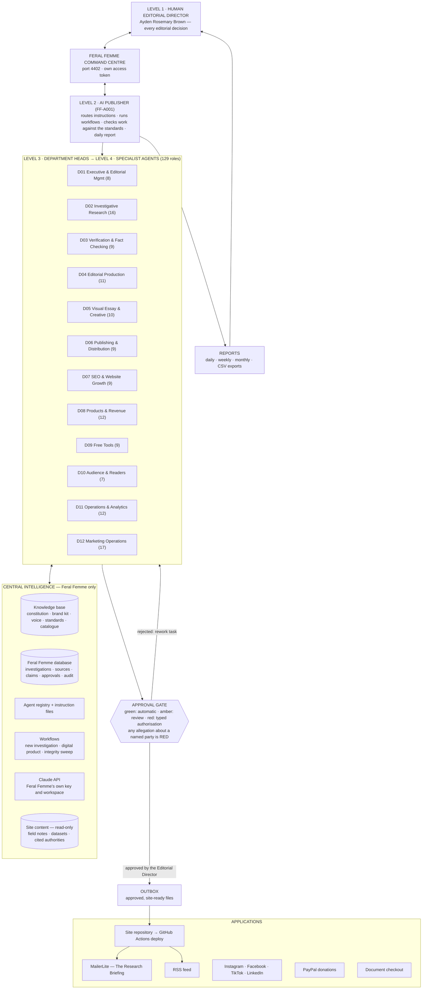

# Feral Femme — system architecture

## The editorial pipeline and its four human gates

```mermaid
flowchart LR
  a[Opportunity] --> b[Research brief] --> c[Sources gathered] --> d[Sources checked] --> e[Evidence classified]
  e --> g1{{"GATE 1 · amber<br/>person verifies each claim against its source"}}
  g1 --> f[Draft] --> h[Fact check] --> i[Voice check]
  i --> g2{{"GATE 2 · amber<br/>editorial review"}}
  g2 --> j[Visual brief + disclosure]
  j --> g3{{"GATE 3 · amber, or RED if any allegation<br/>approve for publication"}}
  g3 --> k[Site-ready file] --> l[Briefing] --> m[Social captions]
  m --> g4{{"GATE 4 · amber<br/>social posts"}} --> n[Archive]
```

No draft exists until a person has confirmed the verification sheet. That is the platform's published standard — "every factual claim … is verified against the named source by a human before publication" — enforced as a step that cannot be skipped.

## What the automated checks do, and do not do
They confirm **structure**: a source has a publisher, title, working link, date and type; a claim has a classification and, where needed, a source; an allegation says who alleges it; every figure in the draft appears on the verification sheet; every publisher is credited by name; the voice is restrained. They do **not** decide whether a source says what a claim says. Only a person does.

## An agent is not a separate Claude subscription
All agents share one orchestrator and one Claude API key for Feral Femme. An agent is a registry entry: an ID, an instruction file, a permission ceiling and, where the job is rule-based, a coded handler. 26 are live as tested code, 82 are ready the moment Claude is connected, 21 wait for a connection.

## Security and editorial protection
- The database, knowledge, registry, credentials and port are Feral Femme's own. The runtime refuses any path outside this business and its one declared mount.
- The site content is mounted **read-only**. The system cannot change a published page. The adapter that writes an approved note into `content/field-notes/` exists, is tested, and is off; turning it on is a deliberate two-setting change.
- Unpublished investigations, sources and drafts live only in the data directory, which is never committed.
- Secrets come from environment variables only: `FF_ANTHROPIC_API_KEY`, `FF_DASHBOARD_TOKEN`, `FF_DATA_DIR`.
- Independence is in every agent's standing instructions: no advertising, sponsorship or affiliate logic may be proposed.
- Subscriber data is not held here. MailerLite remains the record.
- Every step, request, decision and export is in the audit log. Backups: `npm run ff -- backup`.
