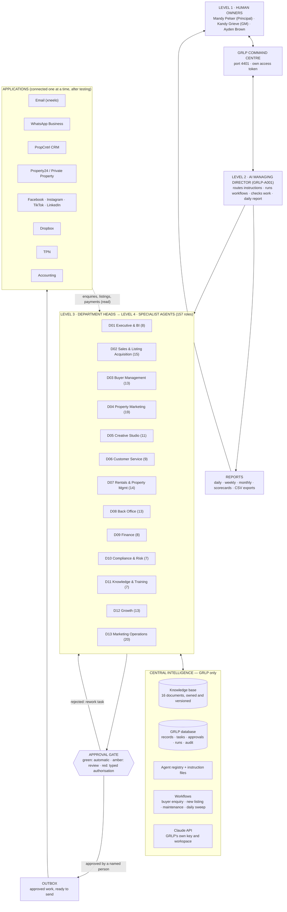

# Garden Route Lifestyle Property — system architecture

## How the levels work
1. **Human owners** decide. Brand and marketing approvals go to Mandy or Kandy, as the Brand Kit requires.
2. **AI Managing Director** receives an instruction, chooses the workflow or agent that owns it, starts the work and reports. If it cannot tell who owns something it logs it as unrouted; it does not guess.
3. **Department heads** own a department's workflows and results.
4. **Specialist agents** each do one defined job. 33 are live as tested code; 104 are instruction profiles that work as soon as Claude is connected; 20 wait for an application to be connected.
5. **Human approval** sits between every agent and the outside world.

## An agent is not a separate Claude subscription
All agents share one orchestrator and one Claude API key for GRLP. An "agent" is a registry entry: an ID, an instruction file, a permission ceiling and, where the job is rule-based, a coded handler. Deterministic work (scoring, matching, checking, tracking) runs as code and costs nothing per use; only writing and judgement calls go to Claude.

## Relationship to the Executive OS
An earlier build on the branch `claude/grlp-ai-executive-os` (a Next.js and PostgreSQL application) covers the principal's executive administration: work routing, escalation, document preparation, mail and WhatsApp ingestion. It is not merged. This workforce layer is deliberately small and self-contained; the sensible next step is to decide whether the Executive OS becomes the system of record that these workflows read from and write to (see the roadmap, wave 4).

## Security and data protection
- GRLP's database, knowledge, registry, credentials and port are its own. The runtime refuses any path outside this business.
- The command centre listens on the local machine only unless an access token is set.
- Secrets are read from environment variables only: `GRLP_ANTHROPIC_API_KEY`, `GRLP_DASHBOARD_TOKEN`, `GRLP_DATA_DIR`. None is stored in a file.
- **POPIA:** buyer records carry a marketing-consent flag; without it the system replies to the enquiry and nothing more. WhatsApp alerts are for opted-in contacts and carry an opt-out.
- **FICA and transaction documents are not stored here.** The system records only whether each document is on file.
- Every step, request, decision and export is in the audit log. Backups: `npm run grlp -- backup`.
- Real client data lives only in the data directory, which is never committed.
